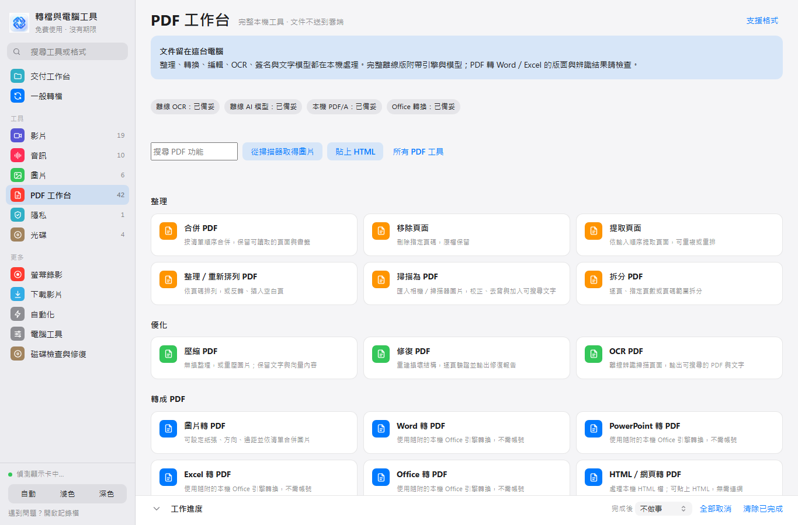
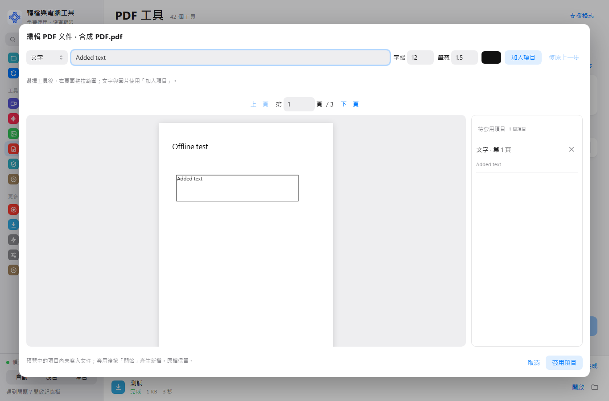
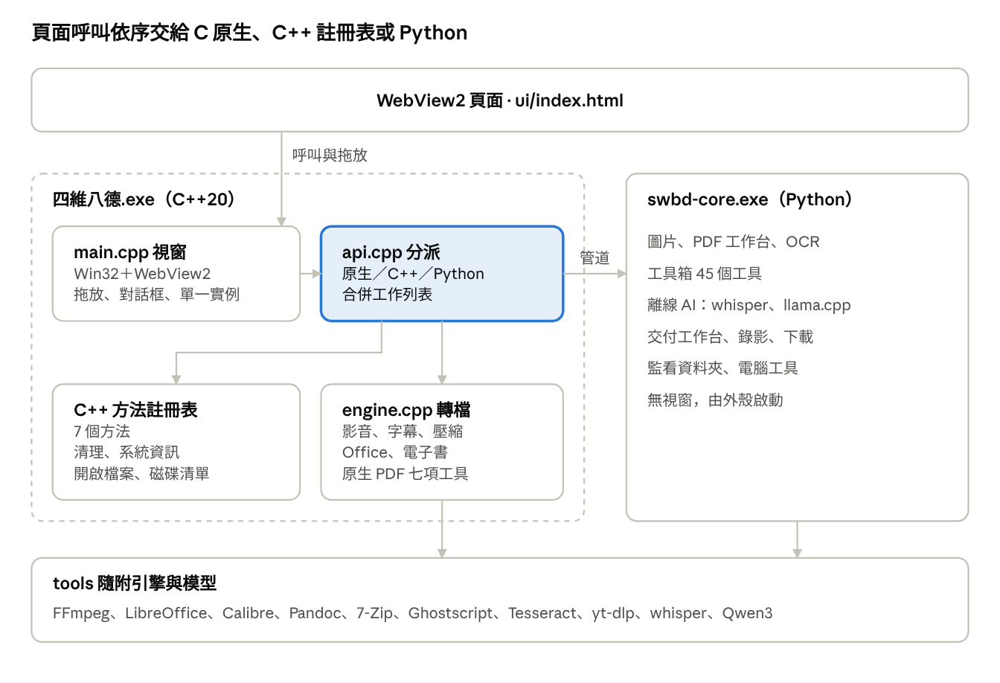

<p align="center">
  
</p>

<h1 align="center">四維八德</h1>

<p align="center">
  <b>完全離線的 Windows 轉檔、PDF 與電腦工具箱</b><br>
  影音、圖片、Office、電子書、壓縮檔、字幕、PDF、OCR、語音辨識、摘要與翻譯，全部在你自己的電腦上完成。
</p>

<p align="center">
  
  
  
  
  
</p>

<p align="center">
  <a href="#下載與安裝">下載與安裝</a> ·
  <a href="#快速開始">快速開始</a> ·
  <a href="#功能總覽">功能總覽</a> ·
  <a href="#從原始碼建置">從原始碼建置</a> ·
  <a href="#技術架構">技術架構</a> ·
  <a href="CHANGELOG.md">版本更新</a> ·
  <a href="CONTRIBUTING.md">參與貢獻</a>
</p>

---

四維八德是一套開源、免費、沒有使用期限的 Windows 桌面工具。它把 FFmpeg、LibreOffice、Calibre、Pandoc、7-Zip、Ghostscript、Tesseract、whisper.cpp、llama.cpp 等引擎與模型全部包進同一個程式資料夾，裝好就能用。不需要另外安裝 Python、Microsoft Office 或任何轉檔軟體，也不需要帳號、API 金鑰或雲端服務。

> [!NOTE]
> 除了「網址下載影片」「更新下載元件」與外部說明連結，所有功能都在本機執行，檔案不會上傳到任何伺服器。

## 目錄

- [特色](#特色)
- [下載與安裝](#下載與安裝)
  - [系統需求](#系統需求)
  - [安裝版](#安裝版)
  - [免安裝版](#免安裝版)
  - [解除安裝](#解除安裝)
- [快速開始](#快速開始)
- [功能總覽](#功能總覽)
  - [一般轉檔](#一般轉檔)
  - [轉檔選項](#轉檔選項)
  - [PDF 工作台](#pdf-工作台)
  - [工具箱](#工具箱)
  - [離線 AI](#離線-ai)
  - [交付工作台](#交付工作台)
  - [螢幕錄影](#螢幕錄影)
  - [下載影片](#下載影片)
  - [自動化](#自動化)
  - [電腦工具與電腦健康檢查](#電腦工具與電腦健康檢查)
  - [操作小技巧與快捷鍵](#操作小技巧與快捷鍵)
- [支援格式](#支援格式)
- [隱私與安全](#隱私與安全)
- [設定與資料位置](#設定與資料位置)
- [常見問題與疑難排解](#常見問題與疑難排解)
- [從原始碼建置](#從原始碼建置)
- [技術架構](#技術架構)
- [專案結構](#專案結構)
- [已知限制](#已知限制)
- [參與貢獻](#參與貢獻)
- [授權](#授權)
- [致謝](#致謝)

## 特色

| | |
| --- | --- |
| **完全離線** | 轉檔、PDF、OCR、語音辨識、摘要、翻譯都在本機執行；不需要帳號或 API 金鑰。 |
| **自帶所有相依** | 引擎、字型、模型與 Visual C++ 執行庫都在程式資料夾內，不依賴電腦上已安裝的版本。 |
| **不覆蓋原檔** | 輸出檔名重複時自動加上 (1)、(2)；永久遮蔽與暫存清理都必須先預覽、再確認。 |
| **先驗證再交付** | 每個工作完成後檢查輸出（影音軌、編碼、PDF 頁數、檔案大小），不合格就判為失敗並說明原因。 |
| **依電腦規格調整** | 自動決定同時處理的工作數；低規格電腦一次只跑一個影片轉檔；轉檔以較低優先權執行，不影響打字上網。 |
| **硬體加速** | 自動偵測 NVIDIA NVENC、Intel Quick Sync、AMD AMF，失敗時自動改用 CPU。 |
| **白話的電腦健康檢查** | 用一般人聽得懂的話說明電腦哪裡有問題、會造成什麼影響、要怎麼處理；沒量到的項目一律標「未測試」。 |
| **原生 Windows 視窗** | C++20 撰寫的 Win32＋WebView2 主程式，支援真實路徑拖放、原生對話框、單一視窗與位置記憶。 |

## 下載與安裝

到 [Releases](https://github.com/welwang/format-converter-factory/releases) 下載最新版。

| 檔案 | 適合 |
| --- | --- |
| `四維八德_<版本>_離線安裝程式.exe` | 一般使用者。建立開始功能表與桌面捷徑，可從 Windows 設定解除安裝。 |
| `四維八德_<版本>_免安裝版.zip` | 不想安裝、要放在隨身碟或多台電腦使用。解壓縮後執行 `四維八德.exe`。 |

### 系統需求

| 項目 | 需求 |
| --- | --- |
| 作業系統 | Windows 10 或 Windows 11，64 位元（x64）。32 位元與 Windows 7／8 不支援；ARM64 以 x64 模擬執行，部分硬體加速未驗證。 |
| 處理器 | 一般文書電腦即可；不需要獨立顯示卡，有的話會自動用來加速影片。 |
| 記憶體 | 至少 4 GB；建議 8 GB 以上。AI 摘要、翻譯與大型檔案建議 8–16 GB。 |
| 磁碟空間 | 完整安裝約 5 GB，另需安裝暫存與輸出成品的空間。 |
| 視窗元件 | Microsoft Edge WebView2。Windows 11 與更新過的 Windows 10 已內建；缺少時程式會提示，安裝包也附有離線安裝檔。 |
| 網路 | 只有網址下載影片與更新下載元件需要。 |

### 安裝版

1. 執行 `四維八德_<版本>_離線安裝程式.exe`。
2. 選擇安裝位置與要建立的捷徑。預設裝在 `%LOCALAPPDATA%\Programs\SiWeiBaDe`，**不需要系統管理員權限**。
3. 可選的附加項目：
   - 建立桌面捷徑
   - 加入檔案總管右鍵「傳送到 → 四維八德」
   - 在檔案與資料夾的右鍵選單加入「用四維八德開啟」
4. 安裝完成後開啟四維八德。

安裝程式以 LZMA2 壓縮，解壓字典 64 MB，避免低記憶體電腦安裝失敗。

### 免安裝版

1. 解壓縮 `四維八德_<版本>_免安裝版.zip` 到任意位置（例如隨身碟）。
2. 執行資料夾裡的 `四維八德.exe`。

設定與記錄檔會存在同一個資料夾裡，整個資料夾可以直接複製到另一台 Windows 10／11 電腦使用。資料夾沒有寫入權限時（例如放在 `C:\Program Files`），會改存到 `%LOCALAPPDATA%\ZhuanDangGongChang`。

### 解除安裝

- **安裝版**：Windows「設定 → 應用程式 → 已安裝的應用程式 → 四維八德 → 解除安裝」。設定檔、快取與健康檢查報告會一併移除；你轉出來的成品不會被刪除。
- **免安裝版**：直接刪除資料夾。

## 快速開始

1. **加入檔案**：把檔案或資料夾拖進視窗，或按「加入檔案／加入資料夾」。也可以把檔案拖到 `四維八德.exe` 圖示上，或在檔案總管按右鍵「傳送到 → 四維八德」。
2. **選擇格式**：每個檔案會自動判斷類型並建議格式；要全部轉成同一種格式，用右側的「全部轉成」。
3. **開始**：按「開始轉檔」。下方「工作進度」會顯示進度、速度與剩餘時間，可以個別或全部取消。完成後按「開啟」用預設程式打開成品，按資料夾圖示在檔案總管中定位成品。

失敗的工作會用中文寫出原因，按「重試」可以用完全相同的設定再跑一次。

## 功能總覽

左側側邊欄分成：交付工作台、一般轉檔、工具（影片、音訊、圖片、PDF 工作台、隱私、光碟），以及更多（螢幕錄影、下載影片、自動化、電腦工具）。

### 一般轉檔

| 類型 | 可以做的事 |
| --- | --- |
| 影片 | MP4、MKV、WebM、MOV、AVI、GIF 互轉；轉成音訊；擷取字幕；HEVC／AV1；指定容量；裁剪；合併多段影片；免重新編碼換封裝。 |
| 音訊 | MP3、AAC、M4A、WAV、FLAC、OGG、Opus 互轉；裁剪；合併；音量標準化。 |
| 圖片 | JPG、PNG、WebP、AVIF、ICO、BMP、TIFF 互轉；HEIC、相機 RAW、PSD、SVG 讀取；縮放；多張合成一份 PDF。 |
| 文件 | Word、ODT、RTF、Markdown、HTML、純文字互轉；轉 PDF；轉 EPUB。 |
| 試算表與簡報 | Excel、ODS、CSV 互轉；PowerPoint、ODP 互轉；轉 PDF。支援舊版 `.doc`／`.xls`／`.ppt`。 |
| 電子書 | EPUB、MOBI、AZW3、FB2 轉 EPUB、AZW3、PDF、Word、純文字。 |
| 壓縮檔 | ZIP、7Z、RAR、TAR、GZ、BZ2、XZ、ZST、CAB、ISO 解壓縮或轉成 ZIP／7Z。 |
| 字幕 | SRT、ASS、SSA、VTT 互轉。 |
| 3D 模型 | OBJ、STL、PLY、GLB、glTF、OFF、3MF 轉 GLB、OBJ、STL、PLY。 |

### 轉檔選項

| 選項 | 說明 |
| --- | --- |
| 品質 | 高品質／均衡／小檔案。 |
| 目標大小 | 填入 MB，影片自動計算位元率；JPG、WebP、AVIF 自動調整壓縮品質。 |
| 裁剪 | 影片與音訊的開始、結束秒數。 |
| 高度 | 縮放影片或圖片，寬度依比例調整。 |
| 合併成一個檔案 | 多段影音接成一個檔、多張圖片合成一份 PDF、多份 PDF 合併成一份。 |
| 盡量不重新編碼 | 預設開啟。例如 MKV 轉 MP4 且編碼相容時直接換封裝，幾秒完成且畫質零損失。 |
| 不會越轉越大 | 重新壓縮後反而比原檔大時保留原內容；不放大影片或圖片；音訊不用比來源更高的位元率重新編碼。 |
| 音訊直接取出 | 影片轉 M4A、MP3 等格式時，原音軌已是同一種編碼就直接取出，不重新壓縮。 |
| 音量標準化 | 把音量調成一致響度（-16 LUFS）。 |
| 硬體加速 | 自動偵測 NVENC／Quick Sync／AMF，失敗時自動改用 CPU。 |
| 影片編碼 | 自動（相容優先）、H.264、H.265／HEVC、AV1。HEVC／AV1 用於 MP4、MKV、MOV。 |
| 完整解碼檢查 | 轉檔後完整解碼一次檢查輸出（較慢，適合重要檔案）。 |
| 資源模式 | 依電腦規格調整，或省資源（低規格電腦、一邊工作一邊轉檔）。 |
| 輸出位置 | 原資料夾或指定資料夾。**永遠不覆蓋原檔。** |

上次使用的主題、品質、輸出位置與硬體加速設定會自動記住。

### PDF 工作台

PDF 功能全部自行實作，使用本機開源引擎，不呼叫 iLovePDF 或任何線上服務，也沒有複製其程式、圖示或品牌素材。

<p align="center"></p>

| 分類 | 工具 |
| --- | --- |
| 整理 | 合併 PDF、拆分 PDF（逐頁／指定頁數／頁碼範圍）、移除頁面、提取頁面、重新排列（反轉、插入空白頁）、掃描為 PDF（校正、去背、加入可搜尋文字） |
| 優化 | 壓縮 PDF（無損整理或重壓圖片，保留文字與向量）、修復 PDF（重建結構並輸出修復報告）、OCR PDF（八種語言，輸出可搜尋 PDF 與文字） |
| 轉成 PDF | 圖片轉 PDF（紙張、方向、邊距）、Word／PowerPoint／Excel／其他 Office 轉 PDF、HTML 轉 PDF（只接受本機 HTML，不載入網路資源） |
| 從 PDF 轉換 | PDF 轉 JPG／PNG、提取內嵌圖片、PDF 轉 Word（含 OCR 版）、PDF 轉 PowerPoint、PDF 轉 Excel（含 OCR 版）、PDF 轉 PDF/A-2b（附檢查報告） |
| 編輯 | 添加頁碼、文字或圖片浮水印（透明度、位置、斜向平鋪）、裁剪、加入文字／圖片／形狀／手繪、建立與填寫表單、表單壓平、旋轉 |
| 安全 | 手寫簽名與印章、PFX／P12 憑證數位簽章（離線）、永久遮蔽（真正移除文字與像素並清除隱藏資料）、逐頁比較並產生差異報告、已知密碼解鎖、AES-256 加密 |
| 智慧 | AI 摘要（本機模型或快速重點摘錄）、PDF 翻譯（譯文與雙語對照）、PDF 轉 Markdown（標題、表格、圖片、連結，支援 OCR） |
| 更多 | 複製 PDF、擷取文字／圖片／附件／書籤、壓平表單與註記、掃描文件交付流程（OCR、Word 副本、PDF/A 平行產出，簽章放最後）、可保存的 PDF 工作流程 |

<p align="center"></p>

**使用方式**：左側選「PDF 工作台」，搜尋或點選工具，再加入檔案。編輯、表單、簽名與遮蔽在預覽上拖拉框選；按「套用項目」後，再按「開始」輸出新檔，原稿保留不動。

**使用範圍**：

- OCR 支援繁中、簡中、英文、日文、韓文、德文、法文、西文；辨識品質取決於掃描清晰度與版面。
- PDF 轉 Word／Excel／PowerPoint 是重建文字、表格與圖片；複雜排版、合併儲存格或手寫內容需要人工核對。
- 編輯工具可以新增文字、圖片、形狀與手繪，但不提供像文書軟體一樣任意重排 PDF 原有的文字。
- 手寫簽名與 PFX 憑證簽章是不同工具；離線憑證簽章不含多人邀簽、線上時間戳或撤銷查詢。
- PDF/A-2b 有基本結構與標記檢查；正式歸檔請另做完整 ISO 驗證。
- 永久遮蔽只處理選取的範圍；其他副本、未選取頁面與人工遺漏需要另外檢查。裁剪不等於遮蔽。
- 掃描器需要 Windows WIA 相容驅動；沒有掃描器也可以用照片建立 PDF。

### 工具箱

左邊選工具、中間放檔案、右邊調設定，按「開始」。每個工具的設定會自動記住。需要指定位置的工具（裁切、去浮水印）可以按「在畫面上框選」直接拖拉，影片可用滑桿換到別的時間點對位置。

| 分類 | 工具 |
| --- | --- |
| 影片（19） | 社群一鍵規格（直式短影音、方形、壓到 10／20 MB）、改比例（模糊背景填滿）、裁切畫面、旋轉／翻轉、變速、文字浮水印、圖片浮水印／Logo、去除浮水印、加字幕（燒入或內嵌）、AI 自動字幕、配樂／換音軌、去除聲音、分割影片、防手震、畫面調整、淡入淡出、倒轉播放、擷取畫面／縮圖總覽、多支影片並排 |
| 音訊（10） | 音量／淡入淡出、變速／變調、去人聲（伴奏）、降噪、去除靜音、混音、鈴聲製作（iPhone M4R／Android MP3）、歌曲資訊與封面、音檔轉文字、會議總結 |
| 圖片（6） | 批次縮放、旋轉／翻轉／裁切、圖片浮水印（可斜向平鋪）、拼長圖／九宮格、圖片轉影片（轉場、背景音樂）、圖片轉 GIF 動畫 |
| PDF（5） | PDF 分割、頁面整理（挑頁、刪頁、重排）、PDF 旋轉、PDF 加密、PDF 解除密碼 |
| 隱私（1） | 隱私清除：移除照片的 GPS 與拍攝資訊、影片的地點與時間、PDF 作者；JPG／PNG 不重新壓縮，畫質不變 |
| 光碟（4） | DVD 轉影片、藍光轉影片（僅限無防拷光碟）、音樂 CD 轉 FLAC／MP3、光碟轉 ISO |

### 離線 AI

| 功能 | 說明 | 引擎 |
| --- | --- | --- |
| AI 自動字幕 | 影片離線辨識成字幕，可燒入或輸出 SRT。中文自動轉成繁體台灣用語。 | whisper.cpp（FFmpeg whisper 濾鏡）＋ggml-base＋Silero VAD |
| 音檔轉文字 | 錄音或影片轉成逐字稿：Word（附時間）、純文字、SRT；依停頓自動分段。 | 同上 |
| 會議總結 | 會議錄音轉逐字稿，再整理出摘要、重點、決議與待辦事項，輸出 Word、Markdown 與 SRT。可選離線 AI 整理或快速摘錄。 | whisper.cpp＋llama.cpp |
| PDF 摘要／翻譯 | 本機文字模型產生摘要或逐段翻譯，輸出譯文與雙語對照。 | llama.cpp＋Qwen3 0.6B |
| 簡轉繁 | 辨識結果轉成繁體與台灣用語。 | OpenCC 詞庫 |

0.6B 小模型以低規格 CPU 能跑為目標，摘要與翻譯可能有錯，**輸出需要人工核對**。長文件會分段處理，速度取決於硬體。

### 交付工作台

選一個用途、加入素材，就能拿到一個整理好、可以直接交付的成品包。

| 用途 | 產出 |
| --- | --- |
| 附件分享包 | 圖片、影音與文件轉成容易開啟的格式，檢查單檔容量並打包 |
| 商品上架包 | 一次產生方形商品圖、網站 WebP 與縮圖，統一命名 |
| 客戶影片包 | 同一支影片產生原比例、直式與方形版本，附縮圖 |
| 自訂工具流程 | 依順序串接工具箱的工具，可保存成配方並分享給同事 |

工作台也可以：

- 保存與重用自己的設定檔。
- 設定檔名前綴、品質、檔案大小上限、圖片尺寸、浮水印、品牌 Logo、外掛字幕、影片版本尺寸。
- 自動加上 AI 字幕、打包成 ZIP，並對每個成品逐項驗證。

### 螢幕錄影

- 錄整個螢幕或指定區域，可同時錄多個麥克風。
- 開始後視窗自動縮小，按 **Ctrl＋Shift＋F9** 停止。
- 錄影時先寫成 MKV，就算當機或斷電，已錄的部分也不會壞掉；停止後立刻轉成 MP4，存在「影片」資料夾。
- 想錄電腦播放的聲音，請在 Windows「聲音設定 → 錄製」啟用「立體聲混音」。

### 下載影片

- 貼上一個或多個網址，下載影片或只下載聲音，支援上千個網站（yt-dlp）。YouTube 解析元件（Deno）已內建。
- 網站改版導致下載失敗時，按「更新下載元件」。
- **請只下載你有權使用的內容。** 本程式不提供登入、付費牆或 DRM 繞過功能。

### 自動化

- **監控資料夾**：指定資料夾後，之後放進去的檔案會自動轉檔，結果放在該資料夾的「已轉檔」子資料夾，原檔不動。
- **全部完成後**：提示音、開啟資料夾、睡眠或關機（關機前倒數 2 分鐘，可以取消）。下方工作進度列也能直接切換。

### 電腦工具與電腦健康檢查

#### 電腦健康檢查

讓電腦自己檢查自己，再用一般人聽得懂的話說明哪裡有問題、會造成什麼影響、要怎麼處理。技術上做到專業檢測的深度，但不會丟給你一堆 GHz、SMART、WHEA 之類的數字。

**兩種模式**

| 一般模式（預設） | 專業模式 |
| --- | --- |
| 快速（約 1–2 分鐘）或標準（約 3–4 分鐘）一鍵檢查 | 自訂持續負載時間（1、3、10、30 分鐘）與記憶體測試量（256 MB–2 GB） |
| 白話結論與處理建議 | 原始數值、Windows 事件記錄、處理器速度與溫度的時間軸 |
| 清楚標示每個項目的狀態 | 測試覆蓋率、可匯出原始資料（JSON） |

**五個檢查階段**（進度依實際量測更新，不使用假進度條）

1. **認識你的電腦硬體**：讀取處理器、顯示卡、記憶體、實體硬碟與可靠性計數、網路卡、異常裝置、電源計畫、電池；查詢最近 30 天的硬體錯誤、磁碟錯誤、顯示驅動停止回應、非正常關機與藍色畫面記錄；量測閒置時的處理器使用率。
2. **檢查設備是否能正常使用**：硬碟寫入並讀回驗證（128–512 MB）、顯示卡影音編碼、到路由器與網際網路的延遲及掉封包、網址查詢（DNS）。
3. **測試電腦的運算能力**：讓處理器以單核心與全部核心反覆計算答案已知的題目，檢查算得對不對、快不快；記憶體以兩種資料樣式寫入後逐塊比對。
4. **檢查長時間使用的穩定性**：全部核心持續運算，同時每秒記錄處理器速度、使用率、溫度與 Windows 回報的節流原因。
5. **整理完整健康報告**：產生結論、問題解釋與專業資料，並存成文字報告與 JSON。

**檢查項目**：處理器、顯示卡、記憶體、硬碟、散熱、網路連線、其他裝置與驅動程式、系統穩定性、電池（筆電）、連接埠。

**結果分三層**

- **電腦總覽**：一句話結論（例如「發現 1 個需要處理的問題」），加上每個項目的狀態。
- **問題解釋**：這是什麼、這次發現了什麼、會造成什麼影響、建議怎麼做。異常項目提供**引導式故障排除**：列出可能原因，並標示這次量測是否真的找到證據（有證據／未發現證據／無法判斷）。
- **專業資料**：時間軸圖表、各項原始數值、事件記錄與「沒有測到的部分」。

**狀態說明**

| 狀態 | 意思 |
| --- | --- |
| 正常 | 這次量測沒有發現問題。 |
| 需注意 | 還能使用，但有值得注意的跡象。 |
| 異常 | 量到明確的問題，建議儘快處理。 |
| 部分檢查 | 只能檢查一部分（例如記憶體在 Windows 執行中只能測一部分）。 |
| 需要確認 | 有紀錄但無法判定原因（例如非正常關機可能是直接按電源鍵）。 |
| 已停用 | 裝置被停用，可能是正常設定。 |
| 未測試 | 這次沒有量到。**未測試不代表正常。** |

**原則**

- 絕不假裝檢查過：沒量到就標「未測試」並寫出原因，例如完整記憶體檢查需要重新開機、連接埠需要人工插拔、Windows 沒有提供讀取風扇轉速的標準方式。
- 可能原因只依量測證據標示，不靠使用者的選擇認定故障。
- 不修改任何設定或檔案；硬碟測試的暫存檔在結束時刪除。
- 網路測試會連到你的路由器與公用 DNS（1.1.1.1、8.8.8.8）量延遲，可以關閉；不測下載速度。
- 完整記憶體檢查可按「開啟 Windows 記憶體診斷」，由 Windows 在重新開機時檢查。
- 部分硬碟 SMART 計數需要系統管理員權限；溫度來自主機板 ACPI 熱區，不一定是處理器核心溫度，警告門檻依廠商規格而定。
- 檢查期間請先不要轉檔或玩遊戲；有其他工作在執行時不會開始。

#### 其他電腦工具

- **電腦硬體資訊**：處理器、系統、記憶體、執行緒數、建議同時工作數、可用的影音硬體編碼、各磁碟可用空間。
- **硬體短測**：約 10 秒的 CPU、記憶體一致性、磁碟讀寫與影音編碼小測試，產生中文文字報告。
- **暫存清理**：先掃描並預覽要清理的檔案與大小，確認後才刪除。範圍包括四維八德舊暫存、未完成的模型下載、舊診斷記錄與使用者暫存資料夾中 7 天以上的散落檔案；不清理登錄檔，跳過正在使用或已變動的檔案。

> [!NOTE]
> 2.3.4 起已移除「磁碟檢查與修復」。需要時請使用 Windows 內建的 `chkdsk`，或在磁碟「內容 → 工具 → 檢查」執行。

### 操作小技巧與快捷鍵

| 操作 | 方式 |
| --- | --- |
| 加入檔案 | Ctrl＋O |
| 開始 | Ctrl＋Enter |
| 搜尋工具或格式 | Ctrl＋F（輸入副檔名，例如 `heic`、`epub`，可查詢支援情形） |
| 關閉對話框 | Esc |
| 停止螢幕錄影 | Ctrl＋Shift＋F9 |

- **大小對比**：完成的工作會顯示「原本 → 轉完」的大小與省下的百分比。
- **影片資訊**：清單顯示解析度、長度，HDR 影片會標示「HDR」；iPhone HDR 影片轉檔時自動轉成一般色彩，不會發灰。
- **只會開一個視窗**：已經開著時，再從右鍵選單或拖到圖示上的檔案會直接加進現有視窗。
- **背景提醒**：視窗標題顯示整體進度；轉檔時電腦不會自動睡眠；完成時若視窗在背景，工作列圖示會閃爍。
- **小螢幕**：1366×768 等小螢幕會自動改成精簡版面，側邊欄只顯示圖示。
- **主題**：自動、淺色、深色。

## 支援格式

| 類型 | 可讀取 | 可輸出 |
| --- | --- | --- |
| 影片 | mp4 mkv webm mov avi flv wmv m4v ts mts 3gp mpg mpeg gif | mp4 mkv webm mov avi gif、各種音訊、srt |
| 音訊 | mp3 aac m4a wav flac ogg opus wma amr aiff | mp3 aac m4a wav flac ogg opus |
| 圖片 | jpg jpeg png webp avif heic heif ico bmp tif tiff psd svg tga jp2 jfif pcx dds qoi，相機 RAW（cr2 cr3 nef arw dng orf rw2 raf pef srw） | jpg png webp avif ico bmp tiff pdf |
| PDF | pdf | png jpg pdf docx epub txt，以及 PDF 工作台的所有輸出 |
| 文件 | doc docx odt rtf txt md markdown html htm tex rst org | docx odt html md txt epub rtf pdf |
| 試算表與簡報 | xls xlsx ods csv ppt pptx odp | xlsx ods csv pptx odp pdf |
| 電子書 | epub mobi azw3 fb2 | epub mobi azw3 pdf docx txt |
| 壓縮檔 | zip 7z rar tar gz tgz bz2 xz zst cab iso | 解壓縮、zip、7z |
| 字幕 | srt ass ssa vtt sub lrc | srt ass vtt |
| 3D 模型 | obj stl ply glb gltf off 3mf | glb obj stl ply |

**不支援的格式**會直接標示原因：有 DRM 的 Kindle KFX 與舊 AZW、Apple Keynote 與 Numbers（請先在原軟體匯出），WPS 舊格式支援有限。為了品質，2.3.0 起移除 EPUB→MOBI 與 STL→GLB。

## 隱私與安全

- 所有檔案只在本機處理；OCR 與 AI 模型在本機執行，不呼叫雲端 API。
- 憑證密碼不存進設定檔；簽名與編輯內容不寫入一般記錄檔。
- 外部程式以參數陣列啟動、不經過命令殼層；含有 `& | < > ^ % !` 等字元的危險路徑參數會被拒絕。
- 暫存清理先預覽、後確認，預覽在 10 分鐘後失效；有工作在執行時拒絕清理。
- 健康檢查只讀取系統資訊與事件記錄，不修改任何設定。
- 永久遮蔽與本機簽章不等於特定法律認證或完整的文件匿名化，請自行核對輸出。

發現安全性問題請依 [SECURITY.md](SECURITY.md) 私下回報。

## 設定與資料位置

程式資料夾可以寫入時，資料就存在程式資料夾（免安裝版）；否則存在 `%LOCALAPPDATA%\ZhuanDangGongChang`。

| 檔案或資料夾 | 內容 |
| --- | --- |
| `settings.json` | 主題、品質、輸出位置、硬體加速、各工具選項、交付設定檔、監控規則 |
| `window.ini` | 視窗位置與大小 |
| `watch_state.json` | 監控資料夾已處理過的檔案 |
| `hw_cache.json`、`hw_cache_c.json` | 硬體編碼器偵測結果 |
| `ffmpeg_caps.json` | FFmpeg 濾鏡能力快取 |
| `logs\` | 執行記錄（`zdgc.log`、`core.log`、`shell.log`） |
| `hardware-tests\` | 硬體短測與電腦健康檢查的報告（txt＋json） |

## 常見問題與疑難排解

<details>
<summary><b>開啟時提示缺少 WebView2</b></summary>

依提示安裝即可。安裝包與免安裝版的 `tools\WebView2-offline-x64.exe` 是 Microsoft 的離線安裝檔，沒有網路也能安裝。
</details>

<details>
<summary><b>啟動時說缺少某個元件</b></summary>

`tools` 資料夾不完整（例如只複製了部分檔案）。請重新安裝，或重新解壓縮完整的免安裝版。
</details>

<details>
<summary><b>轉檔失敗</b></summary>

工作下方會用中文寫出原因，例如磁碟空間不足、檔案正被其他程式開啟、格式有 DRM。修正後按「重試」。詳細記錄在側邊欄最下方的「開啟記錄檔」（`logs\zdgc.log`）。
</details>

<details>
<summary><b>影片轉檔很慢</b></summary>

確認視窗左下角顯示「硬體加速：NVIDIA NVENC／Intel QSV／AMD AMF」。若顯示使用 CPU，請更新顯示卡驅動。低規格電腦可以在選項改成「小檔案」或降低高度。
</details>

<details>
<summary><b>網址下載失敗</b></summary>

網站可能改版，請按「更新下載元件」。部分網站需要登入或有 DRM，本程式不會繞過。
</details>

<details>
<summary><b>健康檢查顯示「背景元件還是舊版」</b></summary>

畫面已更新但背景元件還沒換新。請重新安裝最新版；自行建置的話，執行 `_build\部署最新候選版.ps1`。
</details>

<details>
<summary><b>健康檢查很多項目是「未測試」</b></summary>

代表這台電腦沒有開放那項資料給一般程式讀取，或那項需要人工操作（例如插拔連接埠）。未測試不代表有問題，也不代表正常。以系統管理員身分執行可以讀到更多硬碟資料。
</details>

<details>
<summary><b>圖示還是舊的</b></summary>

Windows 圖示快取尚未更新，登出再登入即可。
</details>

<details>
<summary><b>想檢查所有功能是否正常</b></summary>

在命令提示字元執行 `swbd-core.exe --selftest <輸出資料夾>`，會自己產生測試檔並逐項檢查，結果寫在 `selftest.log`；加上 `--ai` 會一併檢查語音辨識與會議總結。PDF 功能用 `swbd-core.exe --pdf-selftest <輸出資料夾>`。
</details>

## 從原始碼建置

### 需要的環境

| 工具 | 版本與說明 |
| --- | --- |
| Windows | 10／11 x64 |
| Visual Studio | 2022 或 2026，含「使用 C++ 的桌面開發」工作負載（MSVC、C++20） |
| CMake | 3.25 以上（Visual Studio 內建或另外安裝） |
| Python | 3.12，建立在 `_build\venv`，依 `_build\requirements-lock.txt` 安裝 |
| Inno Setup | 7，放在 `_build\inno\ISCC.exe` |
| WebView2 SDK | 1.0.4258.31，第一次建置時由 `build_shell.ps1` 自動下載到 `_build\shell\sdk` |
| 隨附引擎 | 放在專案根目錄的 `tools\`（見下表），不放進版控 |

`tools\` 需要的檔案（缺少時建置會停止並列出缺件）：

| 元件 | 路徑 |
| --- | --- |
| FFmpeg 9.0.1（含 whisper 濾鏡） | `tools\ffmpeg.exe` |
| 7-Zip | `tools\7z.exe`、`tools\7z.dll` |
| Pandoc 3.12.1 | `tools\pandoc.exe` |
| LibreOffice 26.8 | `tools\libreoffice\program\soffice.exe`＋VC++ 執行庫 |
| Calibre 9.16.0 | `tools\calibre\ebook-convert.exe` |
| yt-dlp、Deno | `tools\yt-dlp.exe`、`tools\deno.exe` |
| Ghostscript | `tools\ghostscript\bin\gswin64c.exe`、`tools\ghostscript\iccprofiles\srgb.icc`＋VC++ 執行庫 |
| Tesseract 語言資料 | `tools\pdf-ocr\tessdata\*.traineddata`（eng、chi_tra 等八種） |
| llama.cpp＋Qwen3 0.6B | `tools\pdf-ai\llama-completion.exe`、`tools\pdf-ai\model.gguf`＋VC++ 執行庫 |
| whisper 模型 | `tools\models\ggml-base.bin`、`tools\models\ggml-silero-v5.1.2.bin` |
| 思源黑體 | `tools\fonts\NotoSansTC-Regular.otf` |
| WebView2 離線安裝檔 | `tools\WebView2-offline-x64.exe` |

各元件的來源網址、版本與授權記錄在 [`source/來源清單.json`](source/來源清單.json) 與 [`授權說明.md`](授權說明.md)。

### 建置步驟

```powershell
# 1. 取得原始碼
git clone https://github.com/welwang/format-converter-factory.git 四維八德
cd 四維八德

# 2. 建立 Python 環境
py -3.12 -m venv _build\venv
_build\venv\Scripts\python.exe -m pip install -r _build\requirements-lock.txt

# 3. 放入 tools\ 與 _build\inno\（見上表）

# 4. 建置、測試並產生安裝程式
powershell -ExecutionPolicy Bypass -File _build\建置安裝包.ps1
```

建置結果在 `_build\release-stage-<時間>\dist\swbd-core`，安裝程式在其中的 `輸出\` 資料夾。建置不會替換你正在使用的程式。

### 建置流程

`_build\build.ps1` 依序執行以下步驟，任何一步失敗就停止：

1. PyInstaller 依 `ZDGC.spec` 建置沒有視窗的背景元件 `swbd-core.exe`（入口 `core.py`）。
2. `_build\shell\build_shell.ps1` 經 CMake 建置 C++ 主程式 `四維八德.exe`（靜態連結 WebView2 Loader，圖示與版本資訊來自 `shell.rc`）。
3. 複製 `tools`、`source`、`assets` 與授權文件。
4. 檢查隨附引擎是否齊全。
5. 以 `四維八德.exe --shell-smoke-test` 檢查視窗與混合工作。
6. `prune_payload.py` 依 `packing-prune.json` 移除用不到的引擎資源。
7. 執行內建自我檢測（`--selftest --ai`）；任何項目失敗或略過就停止打包。
8. 執行 PDF 自我檢測（12 項）。
9. Inno Setup 依 `setup.iss` 產生離線安裝程式。
10. 執行開源發布合規檢查（`_build\compliance\gate_release.ps1`）：產生 SBOM 並比對來源清單。未通過時只提示，不中斷建置；設定 `SWBD_REQUIRE_COMPLIANCE=1` 時會讓建置失敗。

### 輔助腳本

| 腳本 | 用途 |
| --- | --- |
| `重新建置安裝包到桌面.cmd` | 一鍵完成：建置與測試 → 安裝程式與免安裝版放到桌面 → 換上新版程式 → 刪除舊的建置與舊版本。 |
| `_build\建置安裝包.ps1` | 只建置、測試並產生安裝程式。 |
| `_build\部署最新候選版.ps1` | 把最新一次全部測試通過的建置換到專案資料夾（舊檔先備份，失敗自動還原）。 |
| `_build\整理舊檔.ps1` | 刪除已移除功能、舊 Logo、測試資料與舊文件的殘留檔案。 |
| `_build\精簡tools.ps1` | 精簡 `tools` 內不需要的引擎資源。 |
| `_build\logo\make_logo.py` | 由程式產生唯一的 Logo 向量圖；所有尺寸的圖示都從它產生。 |

## 技術架構

<p align="center"></p>

四維八德由兩個行程組成，兩者都只呼叫 `tools` 內的隨附引擎：

| 元件 | 原始碼 | 職責 |
| --- | --- | --- |
| 主程式 `四維八德.exe` | `_build\shell\main.cpp` | C++20 Win32 視窗、WebView2、真實路徑拖放、原生對話框、單一實例、視窗位置記憶、工作列閃爍 |
| 分派層 | `_build\shell\api.cpp` | 方法分派、C++／Python 工作合併、完成通知、防止睡眠與完成後動作 |
| 原生轉檔引擎 | `_build\shell\engine.cpp` | 分類、佇列、影音／字幕／壓縮／Office／電子書轉換、硬體加速、輸出檢查 |
| 方法註冊層 | `_build\cpp\` | 逐方法把 Python 功能接手到 C++；原生 PDF（PDFium、qpdf）、PNG 輸出、系統資訊、暫存清理 |
| 背景元件 `swbd-core.exe` | `_build\src\`（Python 3.12，PyInstaller） | 圖片、PDF 工作台、OCR、AI、工具箱、交付工作台、錄影、下載、監控資料夾、電腦工具與健康檢查 |
| 介面 | `_build\src\ui\index.html` | 單一頁面；以 `window.pywebview.api` 呼叫後端 |

### 行程間通訊

主程式以匿名管道啟動 `swbd-core.exe`，每則訊息是一行 UTF-8 文字，第一個字元表示種類。背景元件啟動後先把真正的 stdin／stdout 移開，第三方程式的輸出只會進記錄檔，不會弄亂協定。

| 方向 | 格式 | 用途 |
| --- | --- | --- |
| 主程式 → 背景 | `Q <json>` | 頁面呼叫 `{"id":n,"m":"方法","a":[參數]}` |
| 主程式 → 背景 | `A <id>\t<json>` | 回覆背景元件的請求（開檔、儲存、選資料夾對話框） |
| 主程式 → 背景 | `E <json>` | 事件：`{"ev":"files","paths":[...]}` 或 `{"ev":"close"}` |
| 背景 → 主程式 | `R <json>` | 給頁面的回覆 `{"id","ok","r"或"e"}`，或拖放事件 `{"ev":"drop"}` |
| 背景 → 主程式 | `S <id>\t<op>\t<參數…>` | 視窗操作：`ready` `open` `folder` `save` `title` `minimize` `restore` `front` `flash` `quit`；id 0 表示不需回覆 |

- 頁面呼叫使用數字 id；主程式自己發給背景元件的呼叫使用 `"c<n>"` 字串 id。
- C++ 引擎的工作 id 以 `x` 開頭，避免與 Python 工作 id 衝突。

### 方法分派

頁面的每個呼叫依序交給三個處理者，第一個認得的就回答；三者的回覆格式相同。

1. **C++ 原生清單**：`describe`、`formats`、`media_info`、`hwinfo`、`start`、`status`、`cancel`、`cancel_all`、`clear_done`、`retry`、`compare_job`、`preview`、`cancel_shutdown`。`start` 會把原生引擎認得的檔案留在 C++，其餘轉給 Python，再合併工作清單。
2. **C++ 方法註冊表**（7 個）：`run_tool`、`drives`、`open_file`、`reveal`、`system_info`、`cleanup_scan`、`cleanup_execute`。
3. **Python 背景元件**：其餘方法，由 16 個執行緒的執行緒池呼叫 `app.Api` 的同名方法。

### 工作引擎規則

| 項目 | 規則 |
| --- | --- |
| 重工作（影音編碼）同時數 | CPU ≤ 4 執行緒或 RAM ≤ 6 GB → 1；否則 CPU÷4，限 2–4 |
| 輕工作（圖片、文件、電子書）同時數 | RAM ≤ 4.5 GB → 1；≤ 8.5 GB → 2；否則 CPU÷2，限 2–6 |
| Office／電子書 | RAM ≤ 8.5 GB 時一次 1 個，否則 2 個 |
| 空間檢查 | 開始前檢查輸出磁碟可用空間，不足就拒絕，不留下壞掉的半成品 |
| 取消 | 結束子行程並刪除未完成的輸出檔 |

## 專案結構

```text
.
├── README.md                     本文件
├── CHANGELOG.md                  版本更新紀錄
├── CONTRIBUTING.md               參與貢獻指南
├── SECURITY.md                   安全性問題回報方式
├── CODE_OF_CONDUCT.md            行為準則
├── LICENSE                       GPL-3.0 全文
├── COPYING.AGPL-3.0              AGPL-3.0 全文
├── 授權說明.md                    第三方元件與授權聲明
├── 使用授權條款.md                使用者授權條款（安裝程式顯示）
├── 開源與散布說明.md              開源散布條件與待確認事項
├── 重新建置安裝包到桌面.cmd        一鍵建置、部署與清理
├── assets/                       Logo、架構圖與介面截圖
├── source/來源清單.json            隨附元件的上游來源與核實狀態
├── autosync/                     本機自動同步到 GitHub 的排程腳本
└── _build/
    ├── build.ps1                 主要建置流程
    ├── setup.iss                 Inno Setup 安裝程式設定
    ├── ZDGC.spec                 PyInstaller 設定（swbd-core.exe）
    ├── requirements*.txt         Python 相依套件（lock 為精確版本）
    ├── logo/                     Logo 向量圖與產生器
    ├── compliance/               開源發布合規閘門（SBOM、來源比對）
    ├── shell/                    C++ 主程式：main / api / engine / plat / json、CMakeLists.txt
    ├── cpp/                      C++ 方法註冊層、PDFium／qpdf 接口、zlib／stb
    └── src/                      Python 背景元件
        ├── core.py               背景元件入口與通訊協定
        ├── app.py                頁面 API
        ├── engine.py             工作佇列與轉檔
        ├── tools.py              工具箱與離線 AI
        ├── pdf_tools.py          PDF 工作台
        ├── pdf_local_engines.py  OCR 與本機文字模型
        ├── workflows.py          交付工作台
        ├── capture.py            錄影、下載、監控資料夾
        ├── system_tools.py       硬體資訊、短測、暫存清理
        ├── health_check.py       電腦健康檢查
        ├── selftest.py           內建自我檢測
        └── ui/                   介面（index.html、pdf.js、pdf.css）
```

## 已知限制

- 尚未在實體 4 GB 電腦、所有 Intel／AMD 顯示卡硬體編碼、實體掃描器與各種光碟上完整驗證。
- 電腦健康檢查讀取 Windows 硬體資訊的部分，在不同廠牌電腦上可讀到的資料不同；讀不到的項目會標「未測試」。
- AI 字幕、摘要與翻譯結果需要人工校對。
- PDF 轉 Office 是重建內容，複雜版面需要人工檢查。
- 圖片、OCR、工具箱、交付工作台、錄影、下載仍由 Python 背景元件處理；之後移植到 C++ 時，必須維持相同的輸出。
- 隨附第三方二進位的完整對應原始碼核實仍有未完成項目，詳見 [`開源與散布說明.md`](開源與散布說明.md) 與 [`source/來源清單.json`](source/來源清單.json)。

## 參與貢獻

歡迎回報問題與提出改善。請先閱讀 [CONTRIBUTING.md](CONTRIBUTING.md) 與 [CODE_OF_CONDUCT.md](CODE_OF_CONDUCT.md)。

- 回報錯誤：到 [Issues](https://github.com/welwang/format-converter-factory/issues) 選「錯誤回報」，附上版本、Windows 版本與 `logs\zdgc.log` 的相關內容。
- 功能建議：選「功能建議」，描述想解決的問題。
- 安全性問題：請勿公開，依 [SECURITY.md](SECURITY.md) 私下回報。

## 授權

- 既有應用程式以 [GNU GPL-3.0](LICENSE) 授權。
- 新增的 PDF 模組使用 PyMuPDF，以 [GNU AGPL-3.0](COPYING.AGPL-3.0) 授權；兩者組合時適用 GPL-3.0 第 13 條。
- 隨附的第三方元件各自保有原授權，詳見 [`授權說明.md`](授權說明.md)；Microsoft 的 WebView2 與 Visual C++ 執行庫依其再散布條件提供。
- 使用者授權條款見 [`使用授權條款.md`](使用授權條款.md)；散布前的注意事項（完整對應原始碼、專利、品牌與內容使用）見 [`開源與散布說明.md`](開源與散布說明.md)。

「四維八德」名稱與 Logo 的使用不包含在開源授權內。

## 致謝

四維八德建立在這些開源專案之上：
[FFmpeg](https://ffmpeg.org) ·
[LibreOffice](https://www.libreoffice.org) ·
[Calibre](https://calibre-ebook.com) ·
[Pandoc](https://pandoc.org) ·
[7-Zip](https://www.7-zip.org) ·
[Ghostscript](https://www.ghostscript.com) ·
[Tesseract](https://github.com/tesseract-ocr/tesseract) ·
[whisper.cpp](https://github.com/ggml-org/whisper.cpp) ·
[llama.cpp](https://github.com/ggml-org/llama.cpp) ·
[Qwen3](https://github.com/QwenLM/Qwen3) ·
[Silero VAD](https://github.com/snakers4/silero-vad) ·
[yt-dlp](https://github.com/yt-dlp/yt-dlp) ·
[Deno](https://deno.com) ·
[PyMuPDF](https://github.com/pymupdf/PyMuPDF) ·
[PDFium](https://pdfium.googlesource.com/pdfium/) ·
[qpdf](https://github.com/qpdf/qpdf) ·
[pypdf](https://github.com/py-pdf/pypdf) ·
[pikepdf](https://github.com/pikepdf/pikepdf) ·
[pyHanko](https://github.com/MatthiasValvekens/pyHanko) ·
[Pillow](https://github.com/python-pillow/Pillow) ·
[LibRaw](https://www.libraw.org) ·
[resvg](https://github.com/linebender/resvg) ·
[trimesh](https://github.com/mikedh/trimesh) ·
[OpenCC](https://github.com/BYVoid/OpenCC) ·
[思源黑體 Noto Sans TC](https://github.com/notofonts/noto-cjk) ·
[zlib](https://zlib.net) ·
[stb](https://github.com/nothings/stb) ·
[PyInstaller](https://pyinstaller.org) ·
[Inno Setup](https://jrsoftware.org/isinfo.php)
